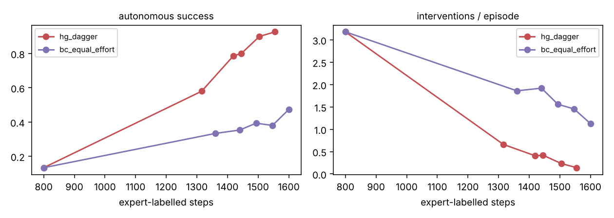
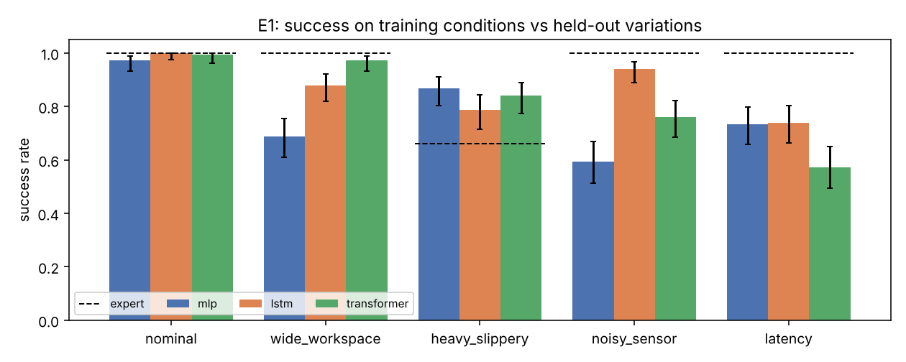

# Reliable Manipulation: imitation learning → interventions → RL, with a reliability evaluation harness

A robot policy that looks perfect on its training conditions often fails once anything shifts: a wider
workspace, a noisy sensor, two steps of control latency. This repo builds the loop that closes that gap,
the way you would for a real deployment:

1. **Collect demonstrations** from a teacher, with injected noise so the data covers recoveries.
2. **Train imitation policies** (MLP, LSTM, causal transformer) and compare them as ablations.
3. **Evaluate reliability, not just accuracy**: success rate, cycle time, interventions per episode and a
   failure category for every miss, on held-out task variations, across seeds, with 95% intervals.
4. **Learn from interventions** (HG-DAgger): a supervisor takes over when the policy stalls, and only those
   takeover segments are added back to the training data. This is the continual-learning loop that should
   drive interventions to zero.
5. *(stage 2)* **Offline → online RL** fine-tuning on top of the imitation policy, with reward design.
6. *(stage 3)* **On-device deployment** on NVIDIA Jetson Thor: quantised policy, control-rate and latency.

Stage 1 (steps 1–4) is complete and runs on a laptop CPU. All numbers below come from the code in this repo.

## Task and variations

MuJoCo **Fetch pick-and-place** (7-DoF arm, parallel gripper, 4-D Cartesian action, 80-step episodes).
Policies only ever train on `nominal`. The other four are held out:

| Variation | What changes |
|---|---|
| `nominal` | object and goal spawn within ±10 cm (training distribution) |
| `wide_workspace` | spawn range widened to ±15 cm |
| `heavy_slippery` | object 8× heavier, 0.25× friction |
| `noisy_sensor` | 5 mm Gaussian noise on gripper and object positions |
| `latency` | every action is applied 2 control steps late |

The teacher is a scripted, **Markov** state-machine expert (its action depends only on the current true
state). That matters for DAgger, where the expert has to label states the learner reached, not states the
expert would have reached itself.

## Metrics

| Metric | Definition |
|---|---|
| Success rate | object within 5 cm of the goal at the end of the episode |
| Cycle time | first step at which the object reaches the goal (successful episodes) |
| Interventions / episode | supervisor takeovers, triggered when task progress stalls for 10 steps; each takeover drives for 8 steps |
| Failure category | `never_grasped`, `dropped`, `carried_not_placed`, `placed_then_drifted` |

Success rates pool episodes across training seeds and report 95% Wilson intervals.

## Results (stage 1)

See **[results/REPORT.md](results/REPORT.md)** for every table and figure. Headline findings:

**1. Learning from interventions is about 5× more label-efficient than adding demonstrations.**
Starting from the same 10 demos (13% success), five HG-DAgger rounds reach **93% success [87–96]** with
**0.14 interventions per episode**, using 1,555 expert-labelled steps. Plain behaviour cloning given the
same expert effort as extra demos reaches only **47% [40–55]** and still needs 1.13 interventions per
episode. Behaviour cloning needs about 100 full demos (8,000 labelled steps) to reach 90% (E2).



**2. Near-perfect training-condition success hides large generalisation gaps, and which architecture wins
depends on the shift.** All three policies score 97–100% on `nominal`. On held-out variations:

| Variation | Expert | MLP | LSTM | Transformer |
|---|---|---|---|---|
| nominal | 100% | 97% | **100%** | 99% |
| wide_workspace | 100% | 69% | 88% | **97%** |
| heavy_slippery | 66% | **87%** | 79% | 84% |
| noisy_sensor | 100% | 59% | **94%** | 76% |
| latency | 100% | **73%** | **74%** | 57% |

- **Memory filters sensor noise.** With 5 mm position noise the memoryless MLP falls to 59%, while the LSTM
  holds 94%, and its successful episodes are twice as fast (19.5 vs 38.8 steps).
- **Latency hurts every architecture**, and the transformer most (57%). None of them was trained with
  delayed actions, so this is the first target for stage 2 (training-time latency randomisation, RL fine-tuning).
- **The policies beat their teacher on `heavy_slippery`** (79–87% vs the expert's 66%). One hypothesis: the
  learned policies transport the object less aggressively than the scripted expert, so a slippery grasp
  survives. This still needs an ablation to confirm.
- **Failure modes differ by architecture.** The MLP mostly fails before grasping (101 of 168 failures are
  `never_grasped`), while the LSTM and transformer mostly fail *after* the object reaches the goal
  (`placed_then_drifted`) or by dropping it. Different failure modes call for different fixes.



**3. Interventions per episode track autonomous success closely** (E2): from 2.67 interventions at
10 demos to 0.03 at 200 on `nominal`, but 0.33 remain on `wide_workspace` even at 200 demos. More of the
same data does not close a distribution shift.

## Repo layout

```
relman/
  envs.py       Fetch pick-and-place + task variations (layout, physics, sensor noise, latency)
  expert.py     Markov scripted expert, task-phase helper
  data.py       demo collection (DART-style noise), normaliser, history windows
  policies.py   MLP / LSTM / causal-transformer BC policies behind one Agent interface
  train.py      behaviour-cloning trainer
  evaluate.py   reliability harness: autonomous + assisted rollouts, failure taxonomy, bootstrap CIs
  dagger.py     HG-DAgger intervention collection
scripts/
  run_experiments.py   E1 architectures, E2 demo scaling, E3 HG-DAgger vs equal-effort BC
  expert_reference.py  teacher's own score on every variation (the ceiling)
  make_report.py       results/*.json -> results/REPORT.md + figures
tests/test_smoke.py
```

## Reproduce

```bash
python -m venv .venv && source .venv/bin/activate
pip install -r requirements.txt
pytest -q tests
python scripts/expert_reference.py
python scripts/run_experiments.py arch      # ~25 min on 1 CPU thread
python scripts/run_experiments.py scaling   # ~15 min
python scripts/run_experiments.py dagger    # ~15 min
python scripts/make_report.py
```

## Roadmap

- [x] **Stage 1**: demos, three BC architectures, held-out variations, reliability harness, HG-DAgger
- [ ] **Stage 2**: offline RL (IQL) on demos + failed rollouts, then online fine-tuning (RLPD-style, demos
      in the replay buffer); compare sparse vs shaped rewards; train with randomised latency and sensor noise
      and re-run E1 to see which failures it fixes
- [ ] **Stage 2b**: action chunking (ACT-style) and a diffusion-policy head as further architecture ablations
- [ ] **Stage 3**: export to ONNX/TensorRT, run on NVIDIA Jetson Thor, report control rate (Hz) and latency
      per architecture and precision
- [ ] **Stage 4**: real hardware: LeRobot SO-100 arm with teleoperated demos and a ROS 2 node
