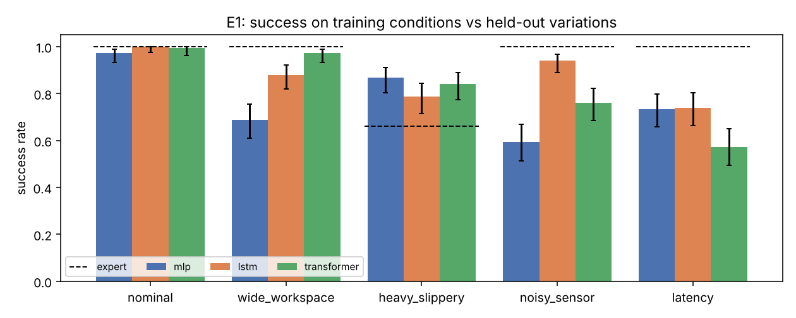
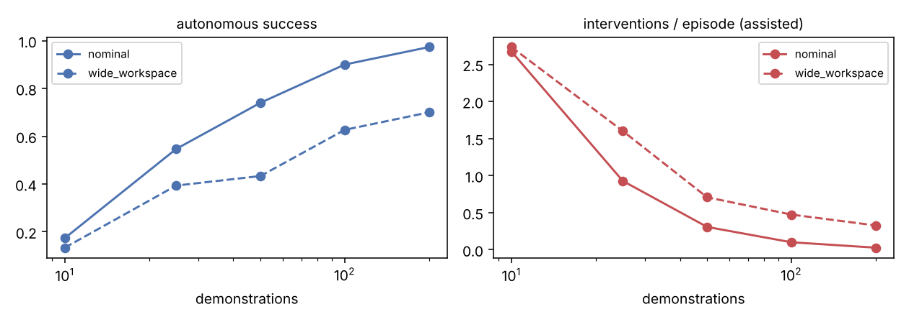
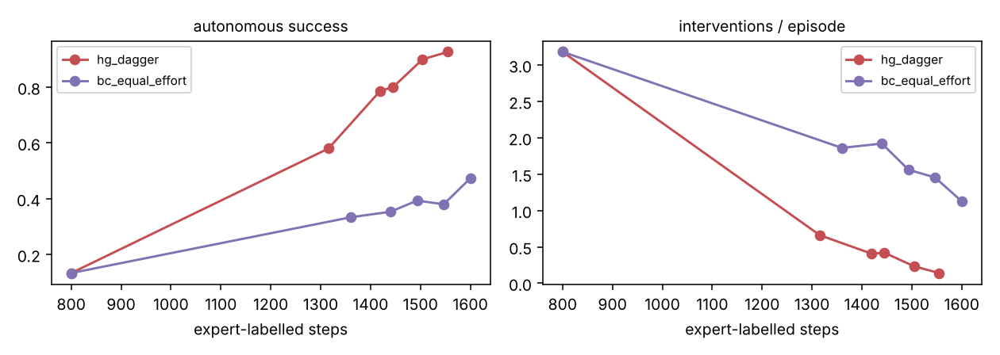
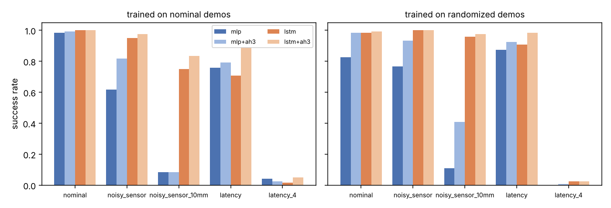
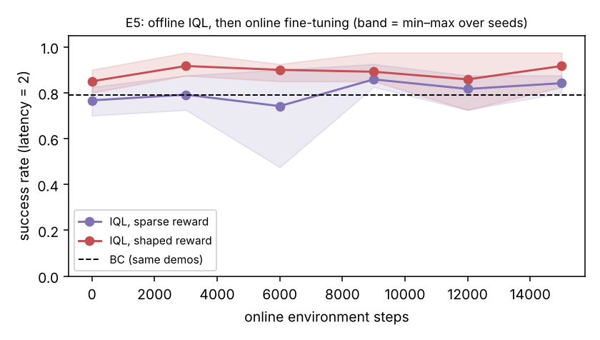

# Stage 1 results

All numbers are produced by `scripts/run_experiments.py` on CPU. Success rates pool episodes across training seeds and show 95% Wilson intervals in brackets. Held-out variations were never seen during training.

## E1 · Architecture vs held-out task variations

100 demos per seed, 3000 gradient steps, 50 evaluation episodes per variation per seed, seeds completed: 3.

| Variation | Expert | MLP | LSTM | Transformer |
|---|---|---|---|---|
| nominal | 100% | 97% [93–99] | 100% [98–100] | 99% [96–100] |
| wide_workspace | 100% | 69% [61–76] | 88% [82–92] | 97% [93–99] |
| heavy_slippery | 66% | 87% [80–91] | 79% [71–84] | 84% [77–89] |
| noisy_sensor | 100% | 59% [51–67] | 94% [89–97] | 76% [69–82] |
| latency | 100% | 73% [66–80] | 74% [66–80] | 57% [49–65] |

Mean cycle time on successful episodes (steps, lower is faster):

| Variation | Expert | mlp | lstm | transformer |
|---|---|---|---|---|
| nominal | 16.6 | 16.7 | 17.1 | 17.3 |
| wide_workspace | 17.8 | 17.4 | 19.6 | 19.5 |
| heavy_slippery | 15.5 | 16.2 | 16.2 | 16.7 |
| noisy_sensor | 16.6 | 38.8 | 19.5 | 35.5 |
| latency | 31.3 | 44.3 | 40.4 | 44.8 |

Failure categories (all seeds, all held-out variations):

| Policy | never_grasped | dropped | carried_not_placed | placed_then_drifted |
|---|---|---|---|---|
| mlp | 101 | 36 | 6 | 25 |
| lstm | 22 | 20 | 10 | 46 |
| transformer | 26 | 51 | 10 | 41 |

## E2 · How many demonstrations does BC need? (MLP)

| Demos | Nominal success | Nominal interventions/ep | Wide-workspace success | Wide interventions/ep |
|---|---|---|---|---|
| 10 | 17% [12–24] | 2.67 | 13% [9–20] | 2.73 |
| 25 | 55% [47–62] | 0.93 | 39% [32–47] | 1.60 |
| 50 | 74% [66–80] | 0.31 | 43% [36–51] | 0.71 |
| 100 | 90% [84–94] | 0.10 | 63% [55–70] | 0.47 |
| 200 | 97% [93–99] | 0.03 | 70% [62–77] | 0.33 |

## E3 · HG-DAgger vs more demonstrations at equal expert effort (MLP)

Both start from 10 demos. Each HG-DAgger round deploys the policy with the supervisor for 20 episodes and adds only the takeover segments. The baseline gets the same number of expert-labelled steps as extra full demonstrations.

| Round | Method | Expert-labelled steps | Autonomous success | Interventions/ep |
|---|---|---|---|---|
| 0 | hg_dagger | 800 | 13% [9–20] | 3.18 |
| 1 | hg_dagger | 1316 | 58% [50–66] | 0.66 |
| 2 | hg_dagger | 1419 | 79% [71–84] | 0.41 |
| 3 | hg_dagger | 1445 | 80% [73–86] | 0.42 |
| 4 | hg_dagger | 1504 | 90% [84–94] | 0.23 |
| 5 | hg_dagger | 1555 | 93% [87–96] | 0.14 |
| 0 | bc_equal_effort | 800 | 13% [9–20] | 3.18 |
| 1 | bc_equal_effort | 1360 | 33% [26–41] | 1.86 |
| 2 | bc_equal_effort | 1440 | 35% [28–43] | 1.92 |
| 3 | bc_equal_effort | 1493 | 39% [32–47] | 1.56 |
| 4 | bc_equal_effort | 1547 | 38% [31–46] | 1.45 |
| 5 | bc_equal_effort | 1600 | 47% [40–55] | 1.13 |

# Stage 2

## E4 · Randomised training and action-history inputs

100 demos per seed, 3000 gradient steps, 40 evaluation episodes per variation per seed. `randomized` demos sample a control latency of 0–3 steps and 0–6 mm sensor noise per episode; `+ah3` policies also see their last 3 commanded actions. `noisy_sensor` (5 mm) and `latency` (2 steps) lie inside the randomisation range; `noisy_sensor_10mm` and `latency_4` lie outside it.

| Train data | Policy | nominal | noisy_sensor | noisy_sensor_10mm | latency | latency_4 |
|---|---|---|---|---|---|---|
| – | *expert (privileged)* | *100%* | *100%* | *100%* | *100%* | *0%* |
| nominal | mlp | 98% [94–100] | 62% [53–70] | 8% [5–15] | 76% [67–83] | 4% [2–9] |
| nominal | mlp+ah3 | 99% [95–100] | 82% [74–88] | 8% [5–15] | 79% [71–85] | 2% [1–7] |
| nominal | lstm | 100% [97–100] | 95% [90–98] | 75% [67–82] | 71% [62–78] | 2% [0–6] |
| nominal | lstm+ah3 | 100% [97–100] | 98% [93–99] | 83% [76–89] | 89% [82–94] | 5% [2–10] |
| randomized | mlp | 82% [75–88] | 77% [68–83] | 11% [6–18] | 88% [80–92] | 0% [0–3] |
| randomized | mlp+ah3 | 98% [94–100] | 93% [87–97] | 41% [32–50] | 92% [86–96] | 1% [0–5] |
| randomized | lstm | 98% [94–100] | 100% [97–100] | 96% [91–98] | 91% [84–95] | 2% [1–7] |
| randomized | lstm+ah3 | 99% [95–100] | 100% [97–100] | 98% [93–99] | 98% [94–100] | 2% [1–7] |

## E5 · Offline → online RL (IQL) in the 2-step-latency setting

Offline data per seed: 100 expert demos on `nominal` + 100 deployment rollouts of the BC policy in `latency` (successes and failures). IQL is trained offline for 10,000 updates, then fine-tuned online for 15,000 environment steps (half of each batch from the offline data). All policies are MLPs with 3-step action history. Success is measured on 40 evaluation episodes per checkpoint per seed.

| Reward | BC | Offline IQL | Online, final | Nominal after fine-tune | Cycle time BC → final |
|---|---|---|---|---|---|
| sparse (seeds=3) | 79% [71–85] | 77% [68–83] | 84% [77–90] | 88% [81–93] | 37.5 → 28.6 |
| shaped (seeds=3) | 79% [71–85] | 85% [78–90] | 92% [85–95] | 89% [82–94] | 37.5 → 31.9 |

